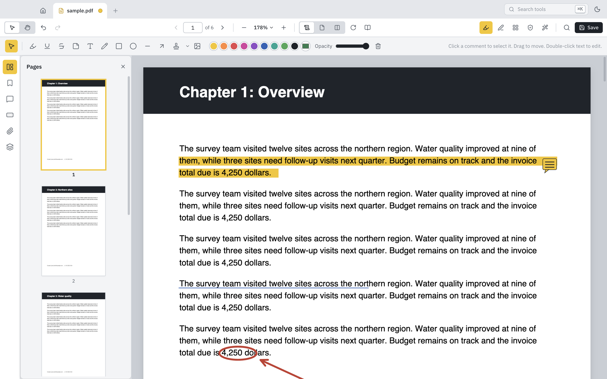
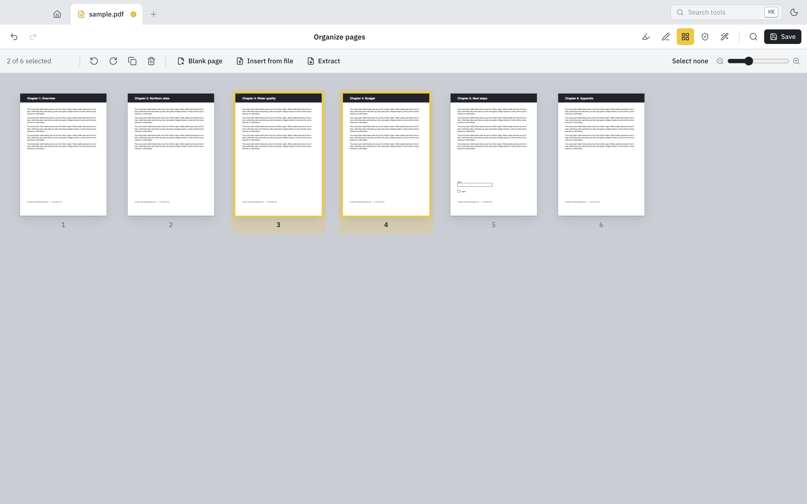
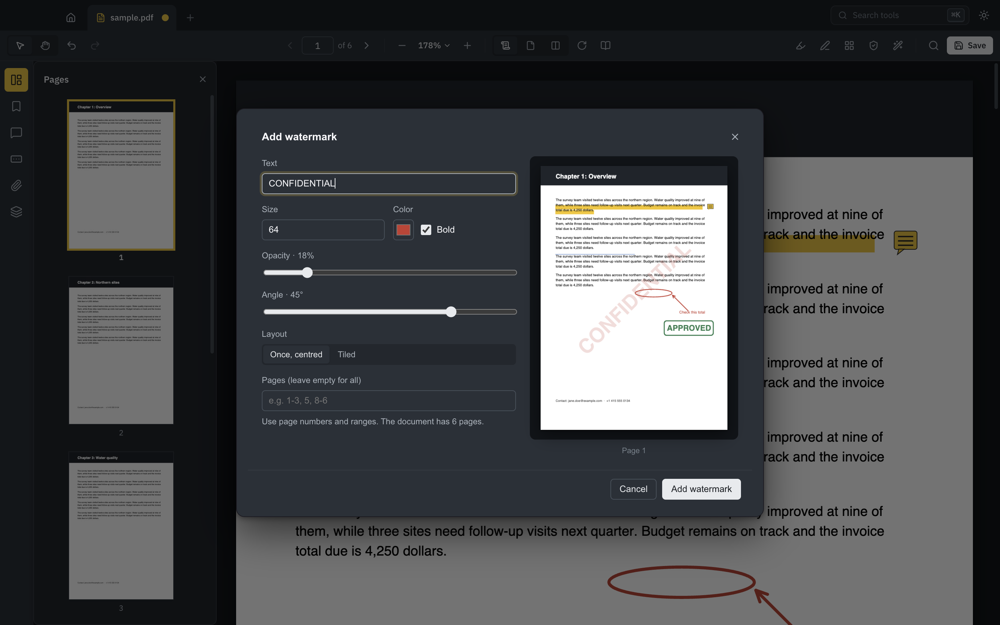
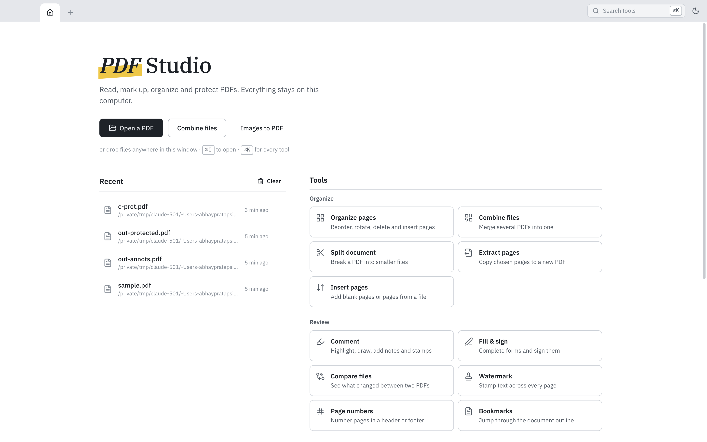
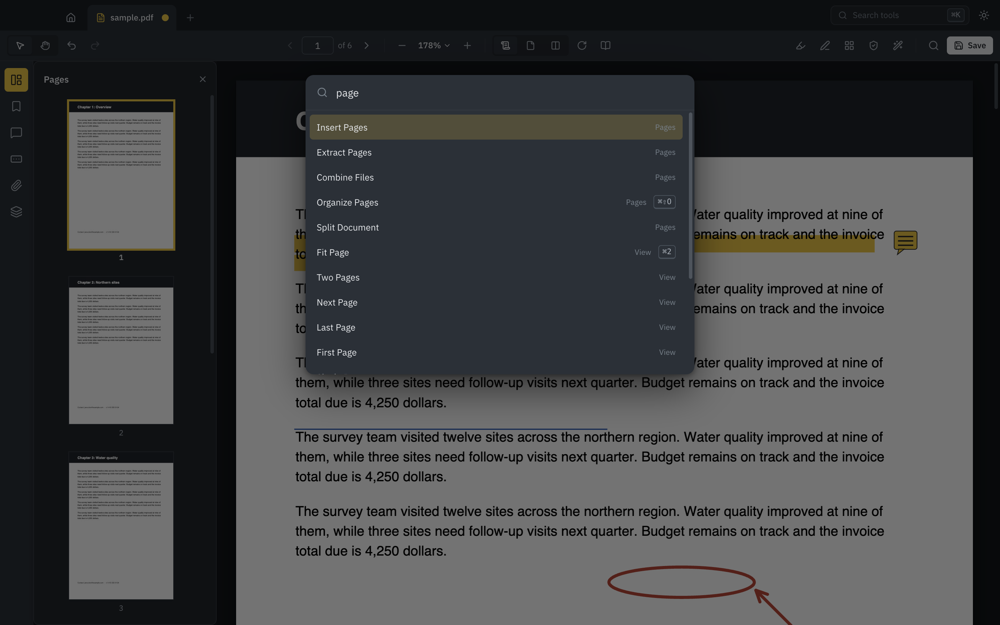

<p align="center">
  
</p>

<h1 align="center">PDF Studio</h1>

<p align="center">
  A fast, private PDF workbench for <b>macOS</b>, <b>Windows</b> and <b>Linux</b> (Ubuntu, Debian, Fedora and any distro via AppImage).<br>
  Read, comment, fill, sign, organize, redact and protect PDFs. Your files never leave your computer.
</p>

<p align="center">
  <a href="https://pdf-studio.devops-monk.com"><b>pdf-studio.devops-monk.com</b></a> ·
  <a href="https://github.com/devops-monk/pdf-studio/releases/latest"><b>Download the latest release</b></a>
</p>



## Features

**Read**
- Smooth, sharp rendering at any zoom; continuous, single-page and two-page layouts; rotate view
- Find as you type with every match highlighted (<kbd>⌘/Ctrl F</kbd>, <kbd>⌘/Ctrl G</kbd>)
- Select and copy text; links work; Read mode and full screen
- Sidebar with page thumbnails, bookmarks (with filter), comments, form fields, attachments and layers
- Light and dark themes, tabs for many documents, recent files, drag and drop

**Comment & fill**
- Highlight, underline and strike through text; sticky notes; text boxes
- Rectangles, ellipses, lines, arrows, freehand drawing, stamps (Approved, Draft, Confidential…) and images
- Move, resize, recolour and delete before saving; saved as standard PDF annotations that other viewers show
- Fill interactive forms; sign with a drawn, typed or image signature (saved for next time), initials, date

**Organize**
- Page grid: drag to reorder, rotate, delete, duplicate, insert blank pages or pages from another file
- Extract pages, split a document (every *n* pages, before chosen pages, or by bookmarks)
- Combine many files into one, with a bookmark per file
- Undo and redo for everything (<kbd>⌘/Ctrl Z</kbd>), labelled by what they undo

**Protect**
- Redact areas or search terms (including emails, phone and card numbers). The content is removed, not just covered
- Password protection with AES-256 and optional permissions; open protected files and keep their password on save
- Edit document properties; inspect fonts, page sizes and security

**Convert & more**
- Watermarks and page numbers, with a live preview
- Compress (lossless repack, or page images for the smallest scans)
- Images to PDF, pages to PNG/JPEG, PDF to text
- Recognize text (OCR) on scanned pages, fully offline, so they become searchable
- Compare two versions with changes highlighted
- Print
- Command palette (<kbd>⌘/Ctrl K</kbd>) to reach every tool

<table>
<tr>
<td width="50%"></td>
<td width="50%"></td>
</tr>
<tr>
<td width="50%"></td>
<td width="50%"></td>
</tr>
</table>

## Install

Download the file for your system from the [latest release](https://github.com/devops-monk/pdf-studio/releases/latest).

| System | File |
|---|---|
| macOS, Apple silicon | `PDF-Studio-<version>-mac-arm64.dmg` |
| macOS, Intel | `PDF-Studio-<version>-mac-x64.dmg` |
| Windows (installer) | `PDF-Studio-<version>-win-x64.exe` (or `-arm64`) |
| Windows (no install) | `PDF-Studio-<version>-portable.exe` |
| Ubuntu / Debian | `PDF-Studio-<version>-linux-amd64.deb` (or `-arm64`) |
| Fedora / RHEL / openSUSE | `PDF-Studio-<version>-linux-x86_64.rpm` |
| Any Linux | `PDF-Studio-<version>-linux-x86_64.AppImage` (or `-arm64`) |

```sh
# Ubuntu / Debian
sudo apt install ./PDF-Studio-*-linux-amd64.deb

# Fedora
sudo dnf install ./PDF-Studio-*-linux-x86_64.rpm

# AppImage
chmod +x PDF-Studio-*.AppImage && ./PDF-Studio-*.AppImage
```

**macOS:** the builds are not notarized yet. If macOS says the app is damaged or can't be opened, run this once:

```sh
xattr -dr com.apple.quarantine "/Applications/PDF Studio.app"
```

**Windows:** SmartScreen may warn about an unrecognized app. Choose *More info → Run anyway*.

## Command line

The same engine is available as `pdf-studio-cli`:

```sh
npm run build:cli
node out/cli/pdf-studio-cli.cjs --help

pdf-studio-cli info report.pdf
pdf-studio-cli combine a.pdf b.pdf --out both.pdf
pdf-studio-cli extract report.pdf --pages 1-3,7 --out summary.pdf
pdf-studio-cli split report.pdf --every 10 --out-dir parts/
pdf-studio-cli rotate scan.pdf --pages 2- --angle 90 --out fixed.pdf
pdf-studio-cli protect report.pdf --password s3cret --no-copy --out locked.pdf
pdf-studio-cli watermark report.pdf --text DRAFT --out draft.pdf
pdf-studio-cli numbers report.pdf --format "Page {n} of {total}" --out numbered.pdf
pdf-studio-cli images photo1.jpg photo2.png --page-size a4 --out photos.pdf
```

## Development

Requirements: Node.js 20 or newer.

```sh
npm install          # also copies pdf.js fonts and CMaps for offline rendering
npm run dev          # start the app with hot reload
npm run typecheck
npm run build        # production build of the app and CLI
npm run dist         # installers for the current OS, written to release/
npm run dist:mac     # or dist:win / dist:linux
```

| Path | What it holds |
|---|---|
| `src/main` | Electron main process: window, native menus, file dialogs, atomic saves, recent files, OCR worker |
| `src/preload` | The small, typed bridge the interface uses to reach the system |
| `src/renderer/src/core` | Document engine: rendering and search (pdf.js), page operations, annotations, encryption (pdf-lib) |
| `src/renderer/src/store` | Open documents, undo history and interface state |
| `src/renderer/src/components` | The interface |
| `cli` | The command-line tool |
| `website` | The product website (static HTML/CSS/JS); `website/deploy.sh` publishes it |
| `build` | App icons for every platform (`npm run icons` regenerates them from `build/icon.svg`) |

## Releases

Every push to `main` is typechecked and built on macOS, Windows and Linux. To publish a release, push a version tag:

```sh
git tag v1.0.1
git push origin v1.0.1
```

The **Release** workflow builds installers on each platform and publishes them, with SHA-256 checksums, as a GitHub Release.

## Privacy

PDF Studio works entirely offline. It has no account, no telemetry and no network calls. Links inside documents open in your browser only when you click them.

## License

MIT
